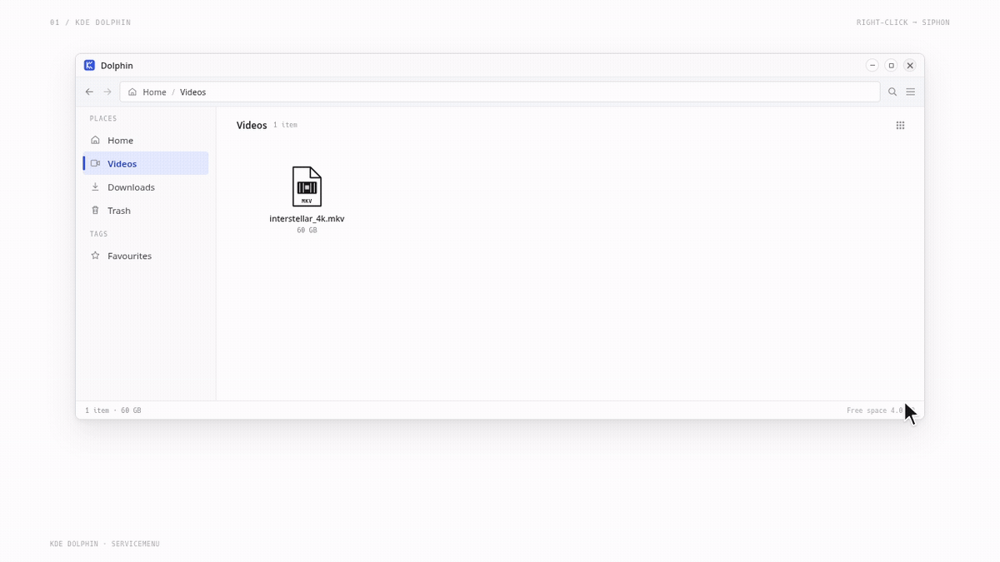
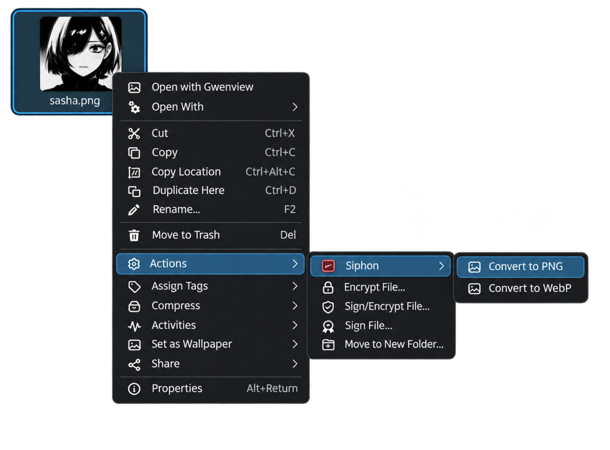

# Siphon

**Convert media in place on Linux, without needing a second full-size copy.**

Siphon checks the conversion plan and available space before it starts. It
writes and verifies the output before consuming the source, and refuses when
it cannot safely handle a file.



Siphon provides a command-line interface and an optional KDE Dolphin
ServiceMenu. It works offline and sends no telemetry.

The static website is in [`site/`](site/) and publishes at
[ashking-tech.github.io/siphon](https://ashking-tech.github.io/siphon/) after
GitHub Pages is enabled for the repository.

## Download v0.2.0

Linux builds are published for amd64 and arm64. Each archive contains the
`siphon` CLI, `README.md`, `LICENSE`, the Dolphin installer, the
`siphon-gui-kde` wrapper, and the ServiceMenus.

| Platform | Archive |
| --- | --- |
| Linux amd64 | [siphon_0.2.0_linux_amd64.tar.gz](https://github.com/Ashking-tech/siphon/releases/download/v0.2.0/siphon_0.2.0_linux_amd64.tar.gz) |
| Linux arm64 | [siphon_0.2.0_linux_arm64.tar.gz](https://github.com/Ashking-tech/siphon/releases/download/v0.2.0/siphon_0.2.0_linux_arm64.tar.gz) |
| SHA256 checksums | [siphon_0.2.0_checksums.txt](https://github.com/Ashking-tech/siphon/releases/download/v0.2.0/siphon_0.2.0_checksums.txt) |

Download the archive for your architecture, verify it, and extract it:

```sh
curl -LO https://github.com/Ashking-tech/siphon/releases/download/v0.2.0/siphon_0.2.0_linux_amd64.tar.gz
curl -LO https://github.com/Ashking-tech/siphon/releases/download/v0.2.0/siphon_0.2.0_checksums.txt
sha256sum --check --ignore-missing siphon_0.2.0_checksums.txt
mkdir -p siphon-0.2.0
tar -xzf siphon_0.2.0_linux_amd64.tar.gz -C siphon-0.2.0
cd siphon-0.2.0
./siphon version
./siphon doctor
```

On arm64, replace `amd64` with `arm64` in the archive name and URL. To add the
Dolphin ServiceMenu, run the installer from the extracted archive:

```sh
./kde/install.sh
```

That installs the CLI and wrapper under `~/.local/bin` and the menus for both
Plasma 5 and 6. Run `./kde/install.sh --help` for `--prefix`, `--plasma`, and
other options.

## Supported conversions

| Category | Conversions |
| --- | --- |
| Video | MKV → MP4, MP4 → MKV, MOV → MKV, MKV → MOV, WebM ↔ MP4, GIF ↔ MP4 |
| Audio | WAV → MP3, video → MP3 (MP4, MKV, MOV, WebM) |
| Images | PNG ↔ JPG, PNG ↔ WebP, JPG ↔ WebP |
| Documents | Single-page PDF → PNG/JPG, PNG/JPG → single-page PDF |

Container conversions remux compatible streams without re-encoding. When a
conversion needs a lossy transcode, Siphon makes that choice explicit. PDF
rendering currently accepts single-page PDFs only.

## How the space-saving modes work

- **`safe`** writes a temporary output beside the source, verifies it, then
  atomically replaces the source. This is the default for images, documents,
  and most audio/video conversions; it needs room for both files while running.
- **`relocate`** is the default for MKV → MP4. It moves verified,
  keyframe-aligned segments one at a time, so extra space is one segment rather
  than another full film. If interrupted, `siphon recover` resumes the job.
- **`reclaim`** is an opt-in mode for WAV → MP3 that reuses space behind the
  read cursor. It requires `--yes` to confirm the in-place operation.

Successful conversions consume the source file. Make a backup first if you
need to keep the original.

## Requirements

- Linux. Go 1.26.9 or newer is only needed to build from source.
- `ffmpeg` and `ffprobe` 5.0 or newer for video and audio conversions.
- `lame` 3.100 or newer for WAV → MP3.
- Poppler (`pdfinfo` and `pdftoppm`, from `poppler-utils`) for PDF → image.
- `cwebp` and `dwebp` (from `libwebp-tools`) for conversions involving WebP.

External tools are required only for the formats that use them. Run
`siphon doctor` to see which tools are installed and which conversions they
enable.

## Build from source

If you prefer to build locally:

```sh
git clone https://github.com/Ashking-tech/siphon.git
cd siphon
make build
./bin/siphon version
./bin/siphon doctor
```

`make build` creates `bin/siphon` with cgo disabled and stamps the version from
the nearest Git tag and the short commit. Inspect a file before converting it:

```sh
./bin/siphon inspect movie.mkv --to mp4
./bin/siphon convert movie.mkv --to mp4
```

More examples:

```sh
# See targets supported for a source file
./bin/siphon inspect photo.png

# Convert an image; choose a background when removing transparency
./bin/siphon convert photo.png --to jpg --bg white

# Extract audio from a video
./bin/siphon convert concert.mkv --to mp3

# Explicitly accept a transcode when WebM and MP4 codecs cannot be remuxed
./bin/siphon convert clip.webm --to mp4 --transcode

# Opt into low-space WAV → MP3 mode
./bin/siphon convert recording.wav --to mp3 --mode reclaim --yes

# Resume a journaled conversion after interruption
./bin/siphon recover movie.mkv
```

`inspect` is a dry run: it reports the plan, space requirement, and any refusal
without changing the source. Use `--json` for machine-readable output.

## KDE Dolphin integration

Install the optional ServiceMenu for Plasma 5, Plasma 6, or both:

```sh
make install-kde                 # both Plasma versions
make install-kde KDEPLASMA=6     # Plasma 6 only
make uninstall-kde
```



Right-click a file, open **Actions**, then **Siphon** to choose a target
format.

The wrapper uses `kdialog` for prompts and batch summaries. It can use `jq` or
Python 3 to parse the CLI's JSON output; `qdbus6`, `qdbus`, or `qdbus-qt6`
enables a live progress bar. Install `libwebp-tools` to enable WebP menu
actions.

## Development

```sh
make test
make vet
make test-kde
```

Useful project references:

- [`spec.md`](spec.md) — core behavior and safety contract.
- [`spec.v0.2-media-formats.md`](spec.v0.2-media-formats.md) — additional
  document, video, and audio conversion rules.
- [`context.md`](context.md) — implementation checkpoint and engineering notes.
- [`site/README.md`](site/README.md) — preview the static website.
- [`video/product-gif/README.md`](video/product-gif/README.md) — product demo
  animation source and render commands.
- [`video/launch/README.md`](video/launch/README.md) — launch film source and
  render commands.

## License

MIT. Copyright (c) 2026 Ashking-tech. See [`LICENSE`](LICENSE).
